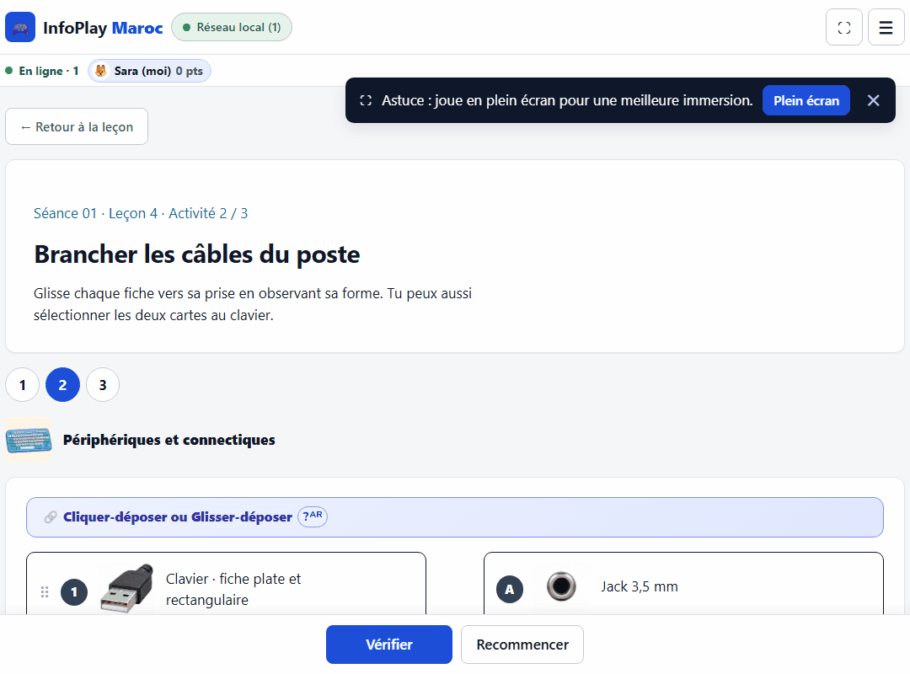
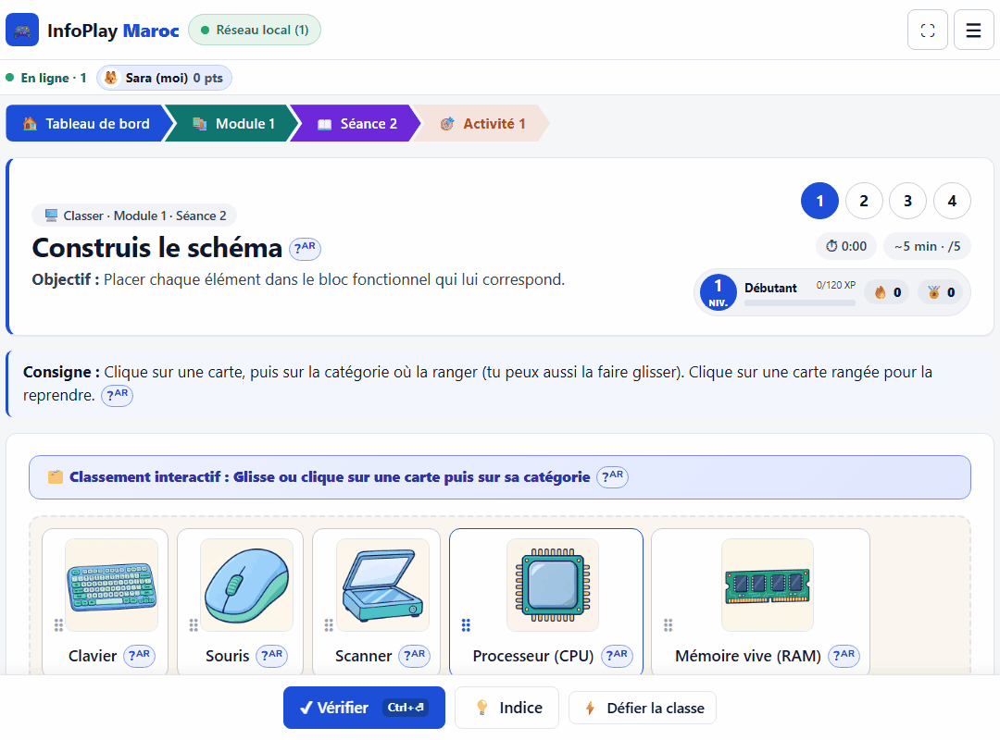
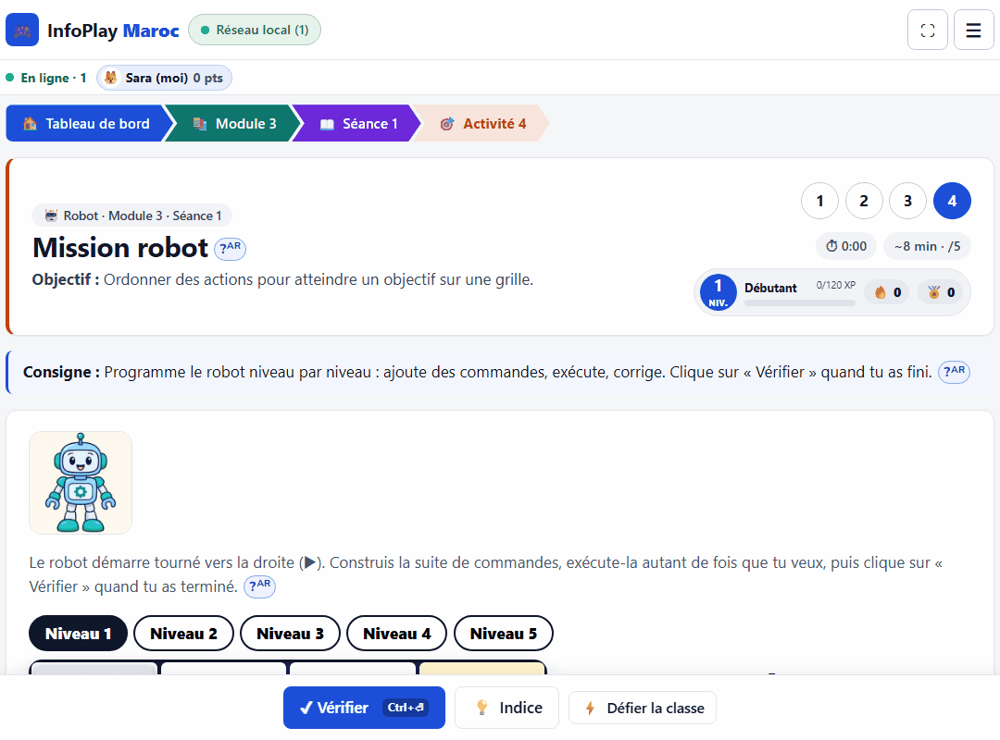
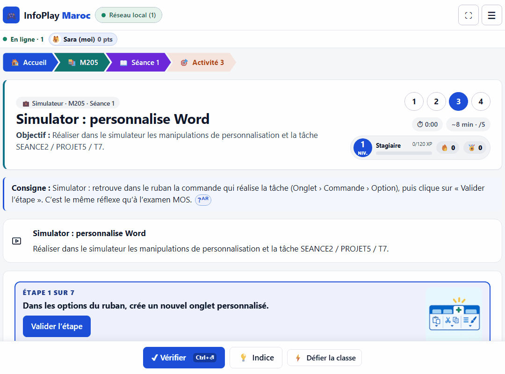

# InfoPlay Maroc 🇲🇦

**Plateforme éducative bilingue et interactive pour apprendre l'informatique au collège en jouant.**

[Ouvrir la démonstration](https://yacineboulyali.github.io/infoplay-maroc/) · 4 modules · 30 séances · 120 activités · 600 points · fonctionnement hors ligne


## Nouveau : parcours OFPPT M205 — Bureautique avancée 💼

Second parcours, indépendant du Tronc Commun (il ne change ni ses 120 activités ni ses 600 points) : **20 séances × 2 h, 80 activités, 400 points**, tirées du cours « M205 Cours complets 20 séances 40 h » (formateur : Yacine Boulyali).

- **Word avancé (S1–S8)**, **Excel avancé (S9–S16)**, **PowerPoint avancé (S17–S18)**, **Outlook et intégration (S19–S20)**.
- Chaque séance commence par une **mission professionnelle** (Atlas Services) et propose 4 mécaniques différentes : associer, classer, ordonner ou compléter, un **Simulator de ruban Office** (même réflexe qu'à l'examen MOS : Onglet › Commande › Option, avec les tâches SEANCE / PROJET / T du document) et une mission-quiz. La séance terminée affiche sa trace écrite « À retenir ».
- Mécaniques ajoutées, fondées sur la recherche en sciences de l'apprentissage :
  - **révision espacée** en boîtes de Leitner (1, 3, 7, 16, 35 jours) à partir de cartes générées depuis les activités ;
  - **indice de certitude** avant de répondre, avec un retour sur l'hypercorrection et la calibration ;
  - **Défi mixte entrelacé** (3 vies, combo ×4) ;
  - **quêtes du jour** et série de jours ;
  - **carte des compétences** par niveaux de maîtrise ;
  - **rangs de carrière**, badges et certificats par partie.
- Accès : bouton « M205 · Bureautique avancée » sur l'accueil, lien **💼 M205 OFPPT** dans le menu (`#/pro`). La progression est enregistrée dans le même profil et exportée dans le CSV enseignant.

## Aperçu

| Tableau de bord | Activité interactive |
| --- | --- |
|  |  |

### Une expérience pensée pour l'élève

- contenu français accompagné d'une traduction arabe discrète ;
- activités de classement, association, ordre, zones cliquables, simulations et programmation ;
- images 3D locales, glisser-déposer et alternative complète par clic/clavier ;
- correction et explications uniquement après **Vérifier** ;
- sons locaux, bouton muet, volume, contraste renforcé, grand texte et mouvements réduits ;
- progression conservée dans le navigateur, export JSON et récapitulatif CSV pour l'enseignant.


## Démonstrations animées

### Associer les câbles à leurs ports (EGTSI106)



### Classer les périphériques selon leur rôle



### Programmer le robot pas à pas



### Personnaliser le ruban Word (M205)



---

# Guide d'installation et d'utilisation

Jeux éducatifs d'informatique pour le collège : **4 modules, 30 séances, 120 activités** (4 par séance, notées sur 5, soit 20 points par séance et 600 points au total). Application **100 % locale** : aucun serveur distant, aucun compte, aucune télémétrie, aucune ressource chargée depuis Internet.

## Démarrer sous Windows (Google Chrome)

Copier le dossier **`dist`** sur l'ordinateur (clé USB, réseau de l'école…). Deux façons de l'ouvrir :

1. **Recommandée : `Lancer-InfoPlay.bat`** (double-clic). Il démarre un petit serveur local (`serve.ps1`, PowerShell fourni avec Windows, écoute seulement `localhost:8765`) puis ouvre Chrome sur `http://localhost:8765/`. L'adresse reste identique à chaque lancement, ce qui garde les résultats au même endroit dans le navigateur. Si Windows demande d'autoriser PowerShell, accepter.
2. **Sans serveur** : double-clic sur `dist/index.html`. Fonctionne aussi, mais l'enregistrement dépend alors du chemin du fichier : **toujours ouvrir le même fichier au même emplacement**, sinon les résultats semblent « disparus ».

> Limites connues : le lanceur Windows (`.bat` + `serve.ps1`) **n'a pas pu être testé sur Windows** dans l'environnement de développement (tests faits sous Linux/Chromium). Faire un essai sur un poste avant le déploiement en classe.

## Suivi de la classe et course sur le réseau local

Un navigateur ne peut pas scanner le réseau : un **ordinateur hôte** (celui de l'enseignant, avec Node.js) lance `Lancer-InfoPlay.bat` (ou `node lan-server.mjs` dans `dist`). La fenêtre du serveur affiche l'adresse à ouvrir sur les postes élèves, par exemple `http://192.168.1.20:8765/`. Chaque page envoie toutes les 2,5 s un signal au serveur : les élèves connectés apparaissent automatiquement.

- **🏁 Course** (`#/course`) : piste en direct, podium, dépassements et exploits annoncés. Sans course lancée, classement sur les points totaux.
- **👀 Suivi** (`#/suivi`) : tableau de chaque élève (en ligne/inactif, activité en cours, activités faites, points, progression par module, dernier résultat, poste), export CSV, et bouton **Lancer la course** (5 à 45 min) : seuls les points gagnés pendant la course comptent.

Ce n'est pas du jeu collaboratif : chacun joue seul. Seuls le pseudo, la classe et les totaux circulent, uniquement sur le réseau local ; tout disparaît à l'arrêt du serveur. **Aucune authentification** : n'importe qui sur le réseau peut ouvrir la page de suivi. Si les postes ne se connectent pas, autoriser Node.js dans le pare-feu Windows (réseau privé). Le serveur de secours PowerShell (sans Node) n'écoute généralement que `localhost` et ne propose pas la course chronométrée.
## Sauvegarde des résultats (important)

Les résultats sont stockés dans le navigateur (Chrome, profil Windows courant). Ils sont **perdus si l'on vide les données du navigateur** ou si l'on change de profil/ordinateur.
- Élève : *Profil et données → Exporter mon profil* (fichier `.json`), à garder sur une clé USB.
- Restauration : *Profil et données → Importer une sauvegarde*. L'import **fusionne** sans rien écraser (les essais déjà présents sont conservés) et rejette les fichiers mal formés.
- Enseignant : l'espace *Espace enseignant (local)* de la même page regroupe les profils importés, avec export CSV (compatible Excel, séparateur `;`). **Il n'y a pas de suivi automatique entre ordinateurs** : chaque élève doit transmettre son fichier.

## Profils élèves

Plusieurs profils par ordinateur. Un profil = prénom ou pseudo + classe facultative. **Pas de mot de passe et aucune sécurité** : un élève peut modifier les données de son navigateur. Ne saisir ni nom complet, ni CIN, ni adresse, ni téléphone.

La page d’accueil présente InfoPlay Maroc et son créateur **ياسين بوليالي (Yacine BOULYALI)**, avec accès direct au mode solo et au mode multijoueur sur réseau local (LAN). Le nouvel élève ne saisit que son prénom ou son pseudo.

## Notes et progression

- Chaque activité : 0 à 5 points. Séance : 0 à 20. Barème de lecture : 16–20 *Très bien* · 12–15 *Bien* · 10–11 *En cours d'acquisition* · 0–9 *À renforcer*.
- Le **premier essai** est enregistré définitivement ; les essais suivants sont conservés à part ; le **meilleur** résultat est affiché séparément.
- Retour immédiat après « Vérifier », avec explication de chaque réponse. Une activité peut être refaite à volonté.

## Accessibilité et confort

Tout est utilisable au clavier (Tab, Entrée, Espace) ; le tri accepte glisser-déposer **et** clic ; les zones d'image ont une liste équivalente ; le résultat n'est jamais donné par la seule couleur (✔/✖ + texte). Réglages dans *Profil et données* : animations réduites, texte plus grand, contraste renforcé.

Les cartes déplacées et les associations utilisent des animations courtes. Les traits montrent uniquement les choix de l’élève : aucune bonne réponse, correction ou explication n’apparaît avant « Vérifier ». Toutes les animations sont supprimées lorsque l’option de réduction des animations est active.

## Sons

Les clics et les résultats utilisent de courts sons synthétisés localement par le navigateur : aucun fichier audio, téléchargement ou appel Internet. Le bouton 🔊/🔇 reste disponible dans l’en-tête. Dans *Profil et données*, chaque élève peut couper tous les sons, régler le volume et activer séparément le son discret au survol (désactivé par défaut). Les informations restent toujours visibles à l’écran et ne dépendent jamais du son.

## Développement

```
npm install            # outils de développement uniquement
npx playwright install chromium # une seule fois, pour les tests navigateur
npm run build          # produit dist/ (aucune dépendance à l'exécution)
npm test               # 258 tests unitaires + intégrité du contenu + moteurs (jsdom)
npm run test:e2e       # Chromium hors ligne sur dist/index.html (file://)
npm run test:axe       # audit d'accessibilité automatique (axe-core)
npm run matrix         # régénère CONTENT_MATRIX.md
node scripts/capture-activity-gifs.cjs # recrée les GIF de démonstration
```
Contenu : `src/data/module-N.js` (données, via le mini-langage `src/data/dsl.js`) ; moteurs de jeu : `src/games/` ; stockage : `src/storage/store.js` ; écrans : `src/app.js`.

## Hypothèses à confirmer (voir IMPLEMENTATION_PLAN.md)

- Le découpage des sujets en séances est celui du cahier des charges (proposition pédagogique) : à confronter à votre progression.
- Langage des séances 7–8 du module 3 : **Python** par défaut (à confirmer).
- Les contenus n'ont pas fait l'objet d'une relecture humaine : relire avant usage en classe.
