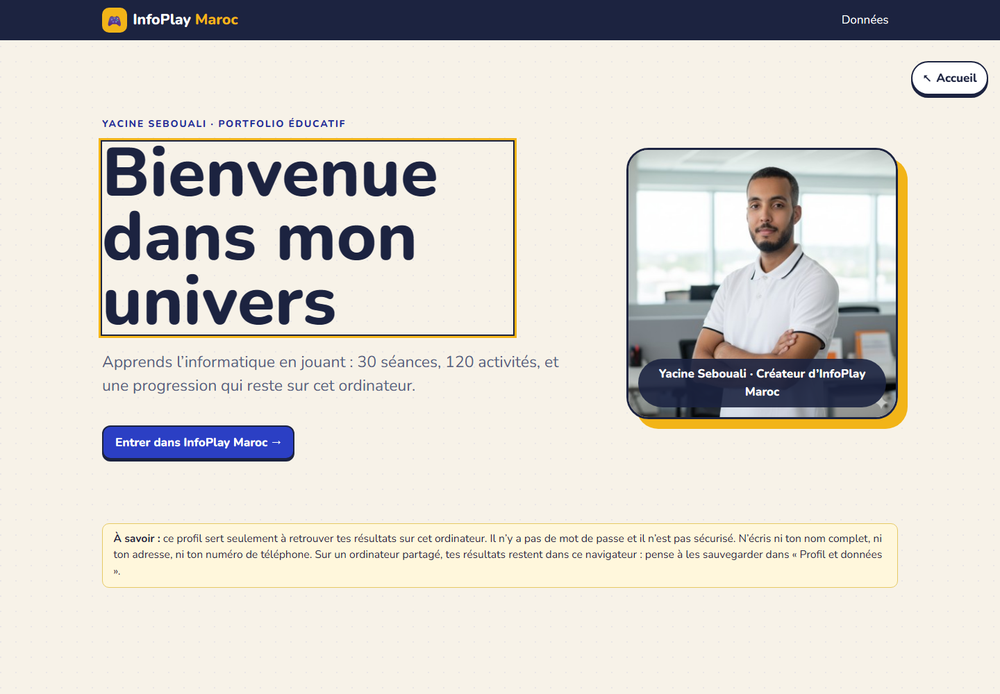
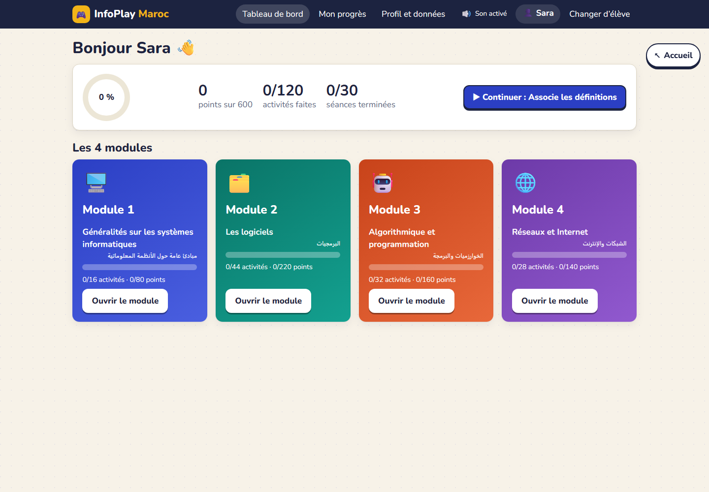
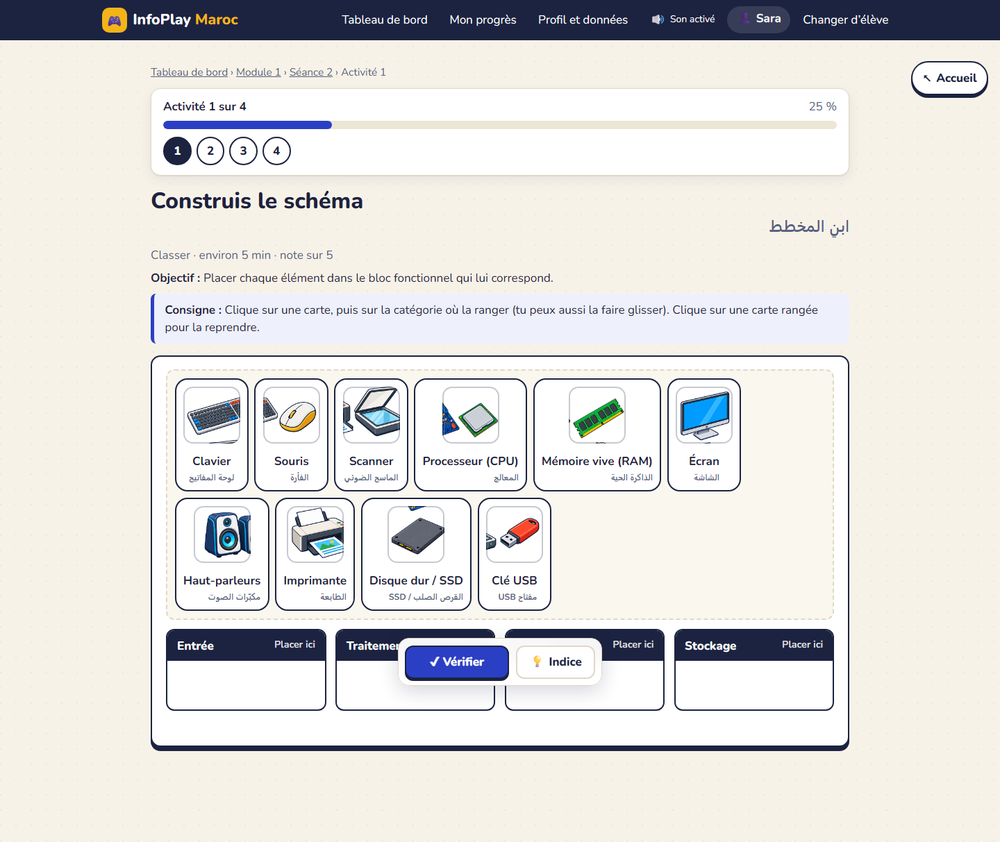
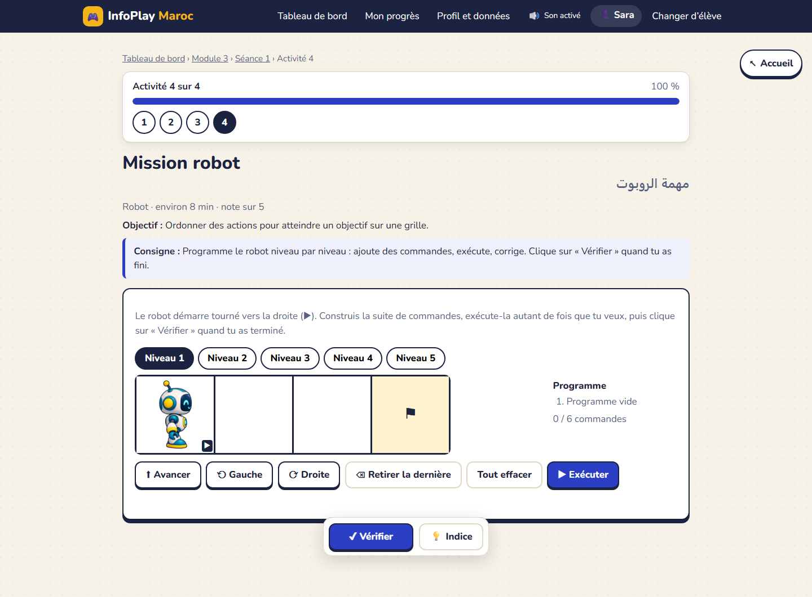
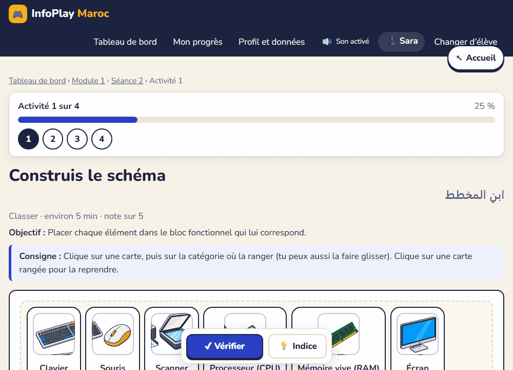
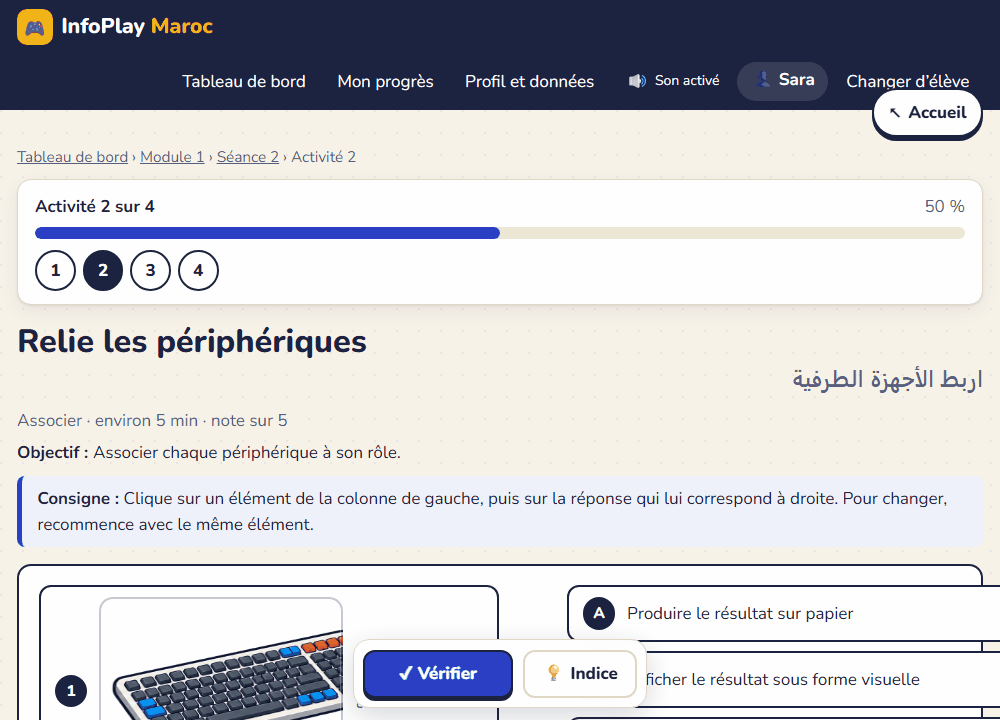
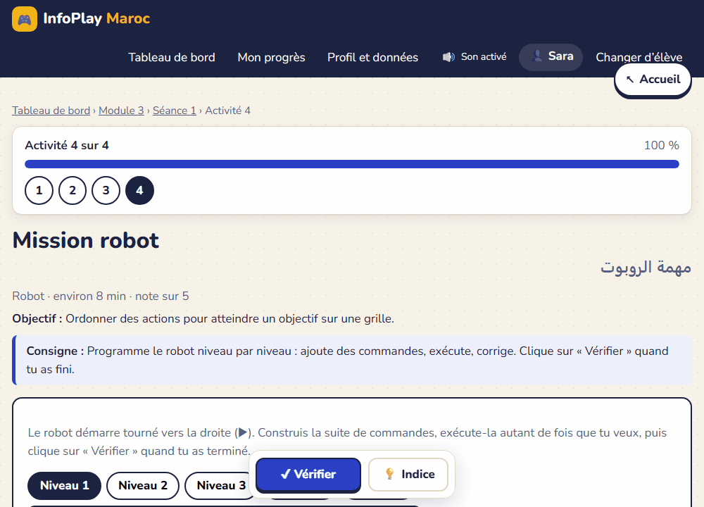

# InfoPlay Maroc 🇲🇦

**Plateforme éducative bilingue et interactive pour apprendre l'informatique au collège en jouant.**

[Ouvrir la démonstration](https://yacineboulyali.github.io/infoplay-maroc/) · 4 modules · 30 séances · 120 activités · 600 points · fonctionnement hors ligne



## Aperçu

| Tableau de bord | Activité interactive |
| --- | --- |
|  |  |

### Une expérience pensée pour l'élève

- contenu français accompagné d'une traduction arabe discrète ;
- activités de classement, association, ordre, zones cliquables, simulations et programmation ;
- images 3D locales, glisser-déposer et alternative complète par clic/clavier ;
- correction et explications uniquement après **Vérifier** ;
- sons locaux, bouton muet, volume, contraste renforcé, grand texte et mouvements réduits ;
- progression conservée dans le navigateur, export JSON et récapitulatif CSV pour l'enseignant.



## Démonstrations animées

### Classer par clic ou glisser-déposer



### Associer des éléments avec des liens visuels



### Programmer le robot pas à pas



---

# Guide d'installation et d'utilisation

Jeux éducatifs d'informatique pour le collège : **4 modules, 30 séances, 120 activités** (4 par séance, notées sur 5, soit 20 points par séance et 600 points au total). Application **100 % locale** : aucun serveur distant, aucun compte, aucune télémétrie, aucune ressource chargée depuis Internet.

## Démarrer sous Windows (Google Chrome)

Copier le dossier **`dist`** sur l'ordinateur (clé USB, réseau de l'école…). Deux façons de l'ouvrir :

1. **Recommandée : `Lancer-InfoPlay.bat`** (double-clic). Il démarre un petit serveur local (`serve.ps1`, PowerShell fourni avec Windows, écoute seulement `localhost:8765`) puis ouvre Chrome sur `http://localhost:8765/`. L'adresse reste identique à chaque lancement, ce qui garde les résultats au même endroit dans le navigateur. Si Windows demande d'autoriser PowerShell, accepter.
2. **Sans serveur** : double-clic sur `dist/index.html`. Fonctionne aussi, mais l'enregistrement dépend alors du chemin du fichier : **toujours ouvrir le même fichier au même emplacement**, sinon les résultats semblent « disparus ».

> Limites connues : le lanceur Windows (`.bat` + `serve.ps1`) **n'a pas pu être testé sur Windows** dans l'environnement de développement (tests faits sous Linux/Chromium). Faire un essai sur un poste avant le déploiement en classe.

## Sauvegarde des résultats (important)

Les résultats sont stockés dans le navigateur (Chrome, profil Windows courant). Ils sont **perdus si l'on vide les données du navigateur** ou si l'on change de profil/ordinateur.
- Élève : *Profil et données → Exporter mon profil* (fichier `.json`), à garder sur une clé USB.
- Restauration : *Profil et données → Importer une sauvegarde*. L'import **fusionne** sans rien écraser (les essais déjà présents sont conservés) et rejette les fichiers mal formés.
- Enseignant : l'espace *Espace enseignant (local)* de la même page regroupe les profils importés, avec export CSV (compatible Excel, séparateur `;`). **Il n'y a pas de suivi automatique entre ordinateurs** : chaque élève doit transmettre son fichier.

## Profils élèves

Plusieurs profils par ordinateur. Un profil = prénom ou pseudo + classe facultative. **Pas de mot de passe et aucune sécurité** : un élève peut modifier les données de son navigateur. Ne saisir ni nom complet, ni CIN, ni adresse, ni téléphone.

La page d’accueil présente d’abord le portfolio éducatif de Yacine Sebouali et son portrait, puis le bouton « Entrer dans InfoPlay Maroc ». Le nouvel élève ne saisit que son prénom ou son pseudo.

## Notes et progression

- Chaque activité : 0 à 5 points. Séance : 0 à 20. Barème de lecture : 16–20 *Très bien* · 12–15 *Bien* · 10–11 *En cours d'acquisition* · 0–9 *À renforcer*.
- Le **premier essai** est enregistré définitivement ; les essais suivants sont conservés à part ; le **meilleur** résultat est affiché séparément.
- Retour immédiat après « Vérifier », avec explication de chaque réponse. Une activité peut être refaite à volonté.

## Accessibilité et confort

Tout est utilisable au clavier (Tab, Entrée, Espace) ; le tri accepte glisser-déposer **et** clic ; les zones d'image ont une liste équivalente ; le résultat n'est jamais donné par la seule couleur (✔/✖ + texte). Réglages dans *Profil et données* : animations réduites, texte plus grand, contraste renforcé.

Les cartes déplacées et les associations utilisent des animations courtes. Les traits montrent uniquement les choix de l’élève : aucune bonne réponse, correction ou explication n’apparaît avant « Vérifier ». Toutes les animations sont supprimées lorsque l’option de réduction des animations est active.

## Sons

Les clics et les résultats utilisent de courts sons synthétisés localement par le navigateur : aucun fichier audio, téléchargement ou appel Internet. Le bouton 🔊/🔇 reste disponible dans l’en-tête. Dans *Profil et données*, chaque élève peut couper tous les sons, régler le volume et activer séparément le son discret au survol (désactivé par défaut). Les informations restent toujours visibles à l’écran et ne dépendent jamais du son.

## Développement

```
npm install            # outils de développement uniquement
npx playwright install chromium # une seule fois, pour les tests navigateur
npm run build          # produit dist/ (aucune dépendance à l'exécution)
npm test               # 258 tests unitaires + intégrité du contenu + moteurs (jsdom)
npm run test:e2e       # Chromium hors ligne sur dist/index.html (file://)
npm run test:axe       # audit d'accessibilité automatique (axe-core)
npm run matrix         # régénère CONTENT_MATRIX.md
node scripts/capture-activity-gifs.cjs # recrée les GIF de démonstration
```
Contenu : `src/data/module-N.js` (données, via le mini-langage `src/data/dsl.js`) ; moteurs de jeu : `src/games/` ; stockage : `src/storage/store.js` ; écrans : `src/app.js`.

## Hypothèses à confirmer (voir IMPLEMENTATION_PLAN.md)

- Le découpage des sujets en séances est celui du cahier des charges (proposition pédagogique) : à confronter à votre progression.
- Langage des séances 7–8 du module 3 : **Python** par défaut (à confirmer).
- Les contenus n'ont pas fait l'objet d'une relecture humaine : relire avant usage en classe.
